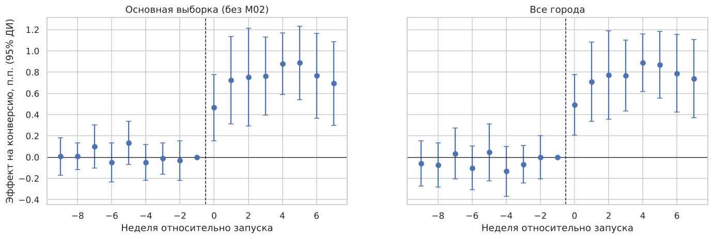
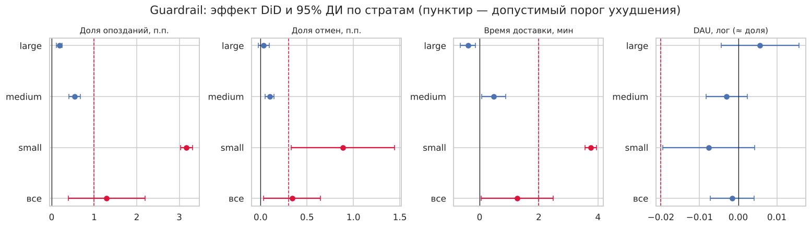

# AB-Session-project — новый алгоритм назначения курьеров: DiD-анализ

МИФИ, сессионное задание по курсу A/B-тестирования. Смоделирован запуск нового алгоритма назначения курьеров
и расчёта обещанного времени доставки (ETA) в сервисе экспресс-доставки продуктов. Алгоритм включили
4 мая 2026 в 8 из 20 городов. Нужно оценить эффект на конверсию, проверить guardrail-метрики и решить, раскатывать ли алгоритм.

**Итог: внедрять в крупных и средних городах, в малых городах откатить и доработать.**
Конверсия выросла на +0.73 п.п. (+6.2%), эффект устойчив ко всем проверкам. Но весь эффект дают крупные и средние
города, а в малых роста нет, при этом опоздания там выросли на 3.2 п.п.

Подробное описание проекта — в [DETAILS.md](DETAILS.md).

[](https://colab.research.google.com/github/JuraMe/AB-Session-project/blob/main/session_project.ipynb)

## Структура репозитория

| Файл | Что внутри |
|---|---|
| `DETAILS.md` | Подробное описание: сценарий, соответствие критериям оценки, что заложено в данные |
| `session_project.ipynb` | Основное решение: исполненный ноутбук с кодом, графиками и выводами |
| `session_project.py` | Тот же анализ в виде Python-скрипта (ячейки `# %%`) |
| `data_generation/generate_data.py` | Генератор данных (seed = 4051), в docstring описано, что заложено в данные |
| `data/city_daily.csv` | Панель «город × день»: 20 городов × 119 дней (2 марта – 28 июня 2026) |
| `data/users_sample.csv` | Выборка 60 000 пользователей (по 1 500 на город до и после запуска) для проверки баланса |
| `figures/` | Графики из ноутбука |
| `requirements.txt` | Зависимости |

## Данные

`city_daily.csv`: `date`, `city` (L01–L06, M01–M07, S01–S07), `stratum` (large / medium / small), `treated` (1 — пилотный город),
`active_users` (DAU), `orders`, `revenue`, `avg_delivery_min`, `late_orders` (доставлено позже обещанного ETA), `cancelled_orders`.

* **Основная метрика:** конверсия `orders / active_users`.
* **Guardrail:** доля опозданий, доля отмен, время доставки, DAU.

В данные специально заложены несовершенства: сильная недельная сезонность, майские праздники с разной силой по стратам,
неслучайный выбор пилотных городов, локальная промо-акция в одном пилотном городе до запуска,
пропуск логов и дубли заказов. В анализе всё это ищется по данным.

Воспроизвести данные:

```bash
python data_generation/generate_data.py 4051
```

## Запуск

```bash
pip install -r requirements.txt
```

```bash
jupyter notebook session_project.ipynb
```

Или скриптом (графики сохранятся в `figures/`):

```bash
python session_project.py
```

В Colab ноутбук сам скачает данные из репозитория, если рядом нет папки `data/`.

## Почему DiD

Обычный A/B по пользователям невозможен: курьеры общие на весь город, и алгоритм для части заказов меняет ETA
и загрузку курьеров у всех (нарушение SUTVA). RDD не подходит (нет порога назначения), PSM — слишком мало единиц
обработки (20 городов), IV — нет инструмента. Есть панель с длинным пред-периодом и контрольными городами,
поэтому выбран **Difference-in-Differences** с эффектами города и «страта × дата», ошибками, кластеризованными по городу,
и дополнительными проверками для малого числа кластеров. Synthetic control — как независимая проверка.
Альтернативный дизайн, если планировать заранее: switchback-тест или рандомизация городов в парах.

## Результаты

### Проверка предпосылок

| Проверка | Результат | Вывод |
|---|---|---|
| Качество данных | S07: нет 5 дней логов; L04: 15.04 заказы задвоены (robust z ≈ 20) | день L04 исключён |
| Сезонность | суббота +1.6 п.п. к понедельнику; праздники −1.38 / −0.81 / −0.34 п.п. по стратам | эффекты «страта × дата» |
| Баланс городов | пилот крупнее по DAU (SMD 0.41), отбор неслучайный | сравнение внутри страт |
| Баланс пользователей | все \|SMD\| < 0.1 в целом и внутри страт | ок |
| Стабильность состава (аналог SRM) | доля DAU пилота 49.70% → 49.64%, p = 0.69; состав не сдвинулся | ок |
| Пред-тренды (линейный тест, event study, плацебо-даты) | p = 0.78; F-тест p = 0.73; все плацебо p > 0.29 | параллельны |
| Плацебо по городам | **M02: +0.62 п.п. за 2 недели до запуска**, вдвое больше любого контрольного города | M02 исключён |

### Эффект на конверсию

| Оценка | Эффект, п.п. | 95% ДИ | p-value |
|---|---|---|---|
| **DiD основной (без M02, город + страта × дата)** | **+0.73** | [+0.41; +1.05] | 0.00015 |
| Wild cluster bootstrap | | | < 0.001 |
| Randomization inference (6 300 перестановок) | | | 0.0008 |
| 12 спецификаций (окна, тренды, веса, агрегация…) | от +0.65 до +1.06 | все исключают 0 | все < 0.001 |
| Synthetic control | +0.80 | | 0.077 (минимум при 12 донорах) |
| Наивная: до/после в пилотных городах | +1.32 | [+1.05; +1.60] | завышена общим ростом |
| Наивная: пилотные vs контрольные после запуска | +1.07 | [+0.82; +1.32] | завышена разницей уровней |

По стратам: **large +1.16 п.п.**, **medium +0.92 п.п.**, **small +0.09 п.п. (незначимо)**; различие эффектов значимо (p < 0.001).

### Guardrail (DiD, порог допустимого ухудшения)

| Страта | Опоздания (порог +1 п.п.) | Отмены (порог +0.3 п.п.) | Время доставки (порог +2 мин) | DAU (порог −2%) |
|---|---|---|---|---|
| large | +0.18 ✅ | +0.03 ✅ | −0.39 ✅ | +0.6% ✅ |
| medium | +0.54 ✅ | +0.10 ✅ | +0.47 ✅ | −0.3% ✅ |
| **small** | **+3.17 ❌** | **+0.89 ❌** | **+3.76 ❌** | −0.8% ✅ |




## Решение

* **Крупные и средние города — внедрять во всех городах страты.** Эффект +8% к конверсии, guardrail в пределах порогов,
  экономика положительная даже в пессимистичном сценарии. В средних городах — мониторинг опозданий с автоматическим откатом.
* **Малые города — откатить в S01 и S02 и не раскатывать.** Роста конверсии нет, опоздания, отмены и время доставки
  значимо хуже допустимого, экономика отрицательная.
* **Доработать алгоритм для городов с малым числом курьеров** (буфер к ETA или включение по порогу плотности курьеров)
  и проверить его в малых городах switchback-тестом.
* Оставить 1–2 контрольных города в крупной и средней страте как holdout ещё на 4 недели и уточнить у маркетинга
  акцию в M02.
